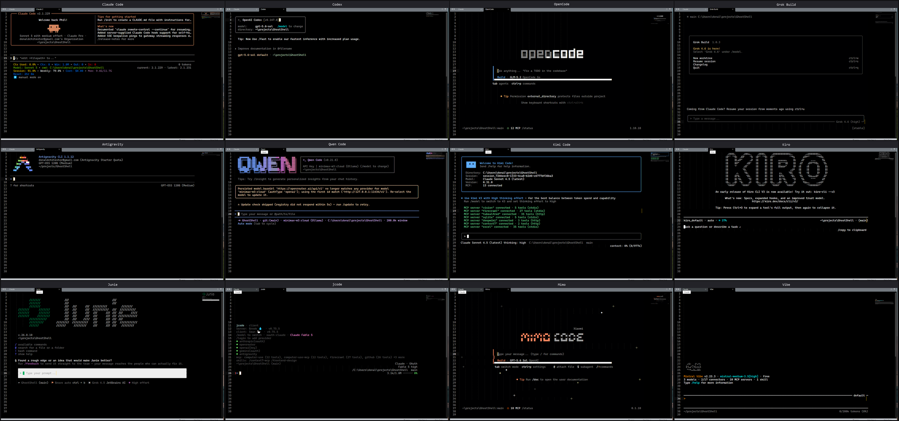

# GhostShell

A terminal for Sublime Text, with profiles for shells and AI coding CLIs,
native editor scrollback, and detachable sessions. GhostShell uses Windows
ConPTY and [libghostty-vt](https://github.com/ghostty-org/ghostty) rather than
depending on another terminal package.



## What GhostShell does now

Releases 0.2.0 to 0.2.15 added the following. The full list, with the reason for
each change, is in [docs/RELEASE_NOTES.md](docs/RELEASE_NOTES.md).

- **Tern Surface Protocol (TSP): a native view for omp.** omp 18.4.4 and newer
  describe their screen as components (cards, lists, markdown, forms, images,
  command blocks, style sheets) instead of rows of characters. GhostShell answers
  omp's probe and draws that description in the Sublime tab, so omp does not
  repaint on resize and its transcript stays live. It is on in the shipped `omp`
  profile (`tsp_enabled`) and opt-in for other profiles. Related settings:
  `tsp_aside_column` (open omp's settings sheet in a column of its own),
  `tsp_tab_status` and `tsp_tab_prefix` (run state and session name in the tab
  label, see [The omp tab label](#the-omp-tab-label)) and `tsp_animation_ms`.
  Tested only with omp 18.11.0. Much fuller support arrived in 0.2.6; the design
  notes are in section 15 of
  [docs/DEVIATIONS_FROM_TERMINUS.md](docs/DEVIATIONS_FROM_TERMINUS.md).
- **One thread.** Since 0.2.7 the broker and the Sublime client run on a single
  asyncio loop instead of reader and writer threads (0.2.8 fixed it on Python 3.8).
  Respawning a broker tab no longer needs a worker thread (0.2.12).
- **Stays responsive in long sessions.** The omp tab redraws only what changed, so a transcript of hundreds of entries no longer keeps the main thread busy, and menus open without searching PATH for every profile (0.2.13).
- **A text log of omp's conversation.** With `log_tab_text` on, the session log also records omp's native view as text, with folded thinking written open (`tsp_log_unfold`), and keeps the earlier conversation after `/new` (0.2.14). The toolbar stays under the last panel and, like omp's permission prompts and buttons, is drawn in omp's style (0.2.14).
- **No command that sends text into a tab.** The four `send_string` and `queue_input` commands are gone (0.2.15): a program types into a tab by selecting it and typing, as a person does. Your own keys reach the program as before.
- **Detachable sessions that survive.** Closing a tab with Ctrl+W detaches the
  session and keeps it running (0.2.10); use **End Session** to stop it. Each
  Sublime keeps its own session registry (0.2.9), so a portable and an installed
  Sublime no longer see each other's sessions; `broker_registry_dir` overrides
  the location. **Sessions > List Sessions** shows what is running.
- **Windows Terminal handoff.** **Move to Windows Terminal** hands a session to
  Windows Terminal (also when the tab is too small, 0.2.7), and **Recover
  Session** takes it back, even while it is busy there (0.2.10). The replay
  records terminal width, so the recovered screen is drawn at the right size.
- **Newer ConPTY, status reports, tones and auto-approve** for Claude Code and omp
  (see [below](#newer-conpty-status-reports-tones-and-auto-approve)).
- **Settings toolbar** in the tab: profile settings are read from disk when you
  change them and the toolbar redraws (0.2.11).
- **Agents and Shells submenus** under the Ai Terminal menu, and `log_root` for
  where logs go. All usage and quota features were removed in 0.2.0.

## Requirements

- **Sublime Text 4, build 4107 or newer, on Windows x64.** The plugin selects
  Sublime's bundled Python 3.8 host via `.python-version`.
- **Windows 10 version 1809 or newer, or Windows 11**, for ConPTY.
- Internet access to GitHub on the first terminal launch, to download the
  pinned native library. See [Native library](#native-library) for offline use.
  Profiles that use the newer ConPTY (the shipped Claude profile) also download
  it once from NuGet; without it they fall back to Windows' built-in ConPTY. See
  [Newer ConPTY](#newer-conpty-status-reports-tones-and-auto-approve).
- Install any shells or AI CLIs you want to use separately and make their
  commands available on `PATH`. GhostShell does not install them or provide
  their accounts, subscriptions, or API access.
- **Detachable sessions**, enabled in the current defaults, additionally need
  a standalone Windows Python installation (`python.exe` and `pythonw.exe`),
  PowerShell, and permission to run a temporary task in Windows Task Scheduler.
  Use Python 3.8 or newer: the scripts parse as Python 3.8, the package was
  loaded and tested on Sublime's 3.8 host, and the broker has been run on 3.12
  and 3.14. Versions older than 3.8 are not supported. Set `broker_python` to the full path to
  `python.exe` if detection picks the wrong interpreter. A Windows Store
  execution alias is not a substitute for an installed interpreter.
- Windows Terminal is optional, only needed for the Windows Terminal handoff
  commands. A monospace font with box-drawing coverage is recommended. Install
  Cascadia Code or override `font_face` if it is not available on your machine.

The distributed native library is Windows x64 only. POSIX-related code in the
repository does **not** mean that macOS or Linux installations are supported.

## Installation

**Not yet listed in Package Control.** Until approved, use a development
checkout. In Sublime Text, choose **Preferences > Browse Packages**, then clone
this repository into a folder named **GhostShell** inside that directory:

```console
git clone https://github.com/dpc00/GhostShell.git GhostShell
```

Alternatively, link an existing checkout from PowerShell (creating a symbolic
link may require Developer Mode or administrator permission):

```powershell
New-Item -ItemType SymbolicLink -Path "<Packages directory>\GhostShell" -Target "<checkout directory>"
```

Use the actual Packages directory opened by Sublime, especially for portable
installations. Keep the folder name `GhostShell`: generated resources and the
settings menu use that package name. Restart Sublime after installation.

After the package is accepted, use **Package Control: Install Package**, then
select **GhostShell**. Do not keep a manual checkout installed alongside the
Package Control installation. The `.no-sublime-package` marker ensures that
the native library and broker scripts have real filesystem paths.

## Quick start and settings

1. Open **GhostShell: Settings** from the command palette, or
   **Preferences > Package Settings > GhostShell > Settings**.
2. Put overrides in the **right-hand User file**, not the left-hand defaults.
   Package updates replace the defaults. The settings filename remains
   `ai_terminal.sublime-settings` for compatibility.
3. Open the **Ai Terminal** menu, then **Agents** (or **Shells**), and pick an
   installed CLI or shell. Agents that are not installed are not shown. Most
   commands use the **Ai Terminal** prefix.

The current defaults still include development-machine profiles. To start
with a plain Windows command prompt, without a detachable broker or full
session recording, use these User settings:

```json
{
    "default_profile": "Command Prompt",
    "log_tab_text": false,
    "record_asciicast": false,
    "shared_spawn_env": {},
    "profiles": {
        "Command Prompt": {
            "launch_command": ["cmd.exe"],
            "detachable": false,
            "spawn_env": {}
        }
    }
}
```

Add other profiles using their CLI command, for example `"launch_command":
["claude"]` or `["codex"]`. Restart Sublime after changing its inherited
`PATH`. Mouse handling, alternate-screen behavior, and page-key routing are
per-profile options, not a guarantee of compatibility with every TUI version.

See [COMMANDS.md](COMMANDS.md) for command names and bindings, and
[detachable sessions](docs/DETACHABLE_SESSIONS.md) for recovery and lifecycle
details. Use **End Session (Kill + Close)** when you want to stop a session,
rather than merely disconnect from a persistent broker.

## Privacy and background activity

Review the defaults before running commands with sensitive output:

- **Session transcripts and asciicast recording are disabled by default**
  (`log_tab_text: false`, `record_asciicast: false`). Enabling either writes
  under `~/data/logs/ghostshell` (the `log_root` setting's shipped value;
  required -- blanking it makes logging fail rather than pick its own
  location). Recordings can contain terminal output and input, including
  credentials and source code. Profiles can override these settings.
  Disabling recording does not remove existing files or disable all
  diagnostic logs.
- Detachable brokers retain a bounded output replay buffer and local registry
  records. Their temporary launch files include the child environment. A
  detachable session's broker process persists in the background across
  Sublime Text restarts (that's the point — it's what makes reconnect work),
  not just while Sublime is open; use **End Session (Kill + Close)** to
  actually terminate one instead of just closing the tab. Review
  [the broker architecture](docs/DETACHABLE_SESSIONS.md) before enabling them
  in a restricted environment. **Removing the package does not stop a
  running broker either** — confirmed directly: deleting the package
  directory while a detachable session is alive leaves its broker and
  child process running, with no package-provided way left to reconnect or
  stop them (`agent_broker.py`/`recover_console.py` are gone too). The same
  is almost certainly true of a Package Control *update* while a session is
  live, for the same reason (the running broker process already has its
  code loaded and never checks the package directory again), though that
  exact combination has not been separately tested. Run **End Session** on
  every open detachable tab (or check for orphaned `python.exe`/
  `pythonw.exe` processes running `agent_broker.py` in Task Manager) before
  uninstalling or updating if you don't want any left running.
- GhostShell shows no usage or quota anywhere, does not read other programs' credentials and does not contact any
  provider's usage endpoint. For usage and quota, use `omp usage`.
- The native library is downloaded from the pinned GitHub Release below.
  Installing GhostShell does not install or authenticate AI CLIs. Commands
  run inside a terminal have their own privacy policies and side effects.

Do not attach recordings or credential settings to public bug reports without
reviewing and redacting them. POSIX-style `0600` file modes do not enforce
private Windows ACLs. Protect the log directories using Windows permissions.

## Native library

`terminal/bin/ghostty-vt.dll` is not tracked in Git. When the first terminal
creates its parser, `terminal/ghostty_vt.py` downloads the pinned binary from a
GitHub Release, verifies its SHA-256, and installs it atomically at that path.
An existing matching file is reused without a download. An offline first
launch fails unless the library is already installed.

For offline installation, download the artifact linked in
[GHOSTTY_VT_PROVENANCE.md](terminal/GHOSTTY_VT_PROVENANCE.md) on a connected
machine, verify its recorded SHA-256, and copy it to
`GhostShell/terminal/bin/ghostty-vt.dll` before launching a terminal.

Developers may set `GHOSTTY_VT_DLL` to an alternative compatible build. This
override bypasses the pinned download **and its checksum enforcement**, so use
only a trusted build. The pinned source revision, fingerprint, and upstream
[MIT license](terminal/GHOSTTY_LICENSE) are included in `terminal/`.

## Newer ConPTY, status reports, tones and auto-approve

Windows' built-in ConPTY swallows some questions that programs ask the terminal
at start-up. Profiles that set `modern_conpty` (the shipped **Claude** profile
does) or `tsp_enabled` use the ConPTY from Windows Terminal instead. On first
use GhostShell downloads Microsoft's `Microsoft.Windows.Console.ConPTY` NuGet
package (x64 only), checks the package hash and then each file's hash, and keeps
`conpty.dll` and `OpenConsole.exe` in `terminal/bin/conpty/` (not tracked in
Git). A wrong hash, no network or a non-x64 CPU prints one line and the tab uses
the built-in ConPTY. Provenance: [CONPTY_PROVENANCE.md](terminal/CONPTY_PROVENANCE.md).
Windows Terminal itself does not have to be installed for this.

With it, Claude Code sends Program Status Protocol (OSC 7501) reports, and
GhostShell answers the probe and records each change of state (working, idle,
blocked, done, error). Two optional settings use those reports. Both are off by
default; set them in your User settings:

- `status_tones`: play a short tone on a change of state (blocked, done or
  error; idle and working are silent). Windows only.
- `auto_approve_permissions`: answer Claude Code's permission prompts with Yes.
  **It approves every permission prompt, deletes included**, and only prompts of
  that kind. It never types over you: it waits until nothing has been typed into
  the terminal for `auto_approve_quiet_seconds` (default 2), checks that the
  prompt is still waiting, and sends Enter (`auto_approve_key` can be `"1"`
  instead). It gives up and leaves the prompt to you after
  `auto_approve_max_wait_seconds` (default 300). The shipped Claude profile turns
  it on for that profile, so check the profile before you rely on the global
  default.

### The omp tab label

omp, when it draws through the Tern Surface Protocol, leaves its run state and
session name out of the window title, so its tab would show only the profile
name. The profile setting `tsp_tab_status` (on in the shipped `omp` profile, off
elsewhere) names the tab the way omp names its own title in a plain terminal:
`tsp_tab_prefix` (omp: `π`), then the run state, then the session name, for
example `π ⠙ PING: Run ping delay command`.

- **Run state**, from omp's OSC 7501 reports: a spinner frame while working, `!`
  while it waits on you (a question or a permission prompt), a check mark when a
  turn is done, a cross on an error, `>` when idle. (omp's own title shows done
  and error as `>`.)
- **Session name**, exactly as omp sends it: its card-form title (`<icon> CODE:
  title`) or the name it announces when a turn finishes, which also carries a
  hand-typed `/rename` (shown at the end of the next turn). Until omp has sent
  one the tab shows the profile name. The titles that omp's helper processes
  (`npm`, MCP servers, `cmd.exe`) write to the same console are not used.

Takes effect for tabs started after the change. Tested on Windows with omp
18.11.0; the error cross has not been seen in testing.

## Development and testing

There is no automated test suite. The owner tests in the live Sublime Text with a debugger and sublime-mcp (see
`AGENTS.md`, rule 7a). The earlier unit tests were removed on 2026-09-21 and remain in git history (last present in
commit `52e2282`).

`python tools/regen_agent_menu.py --check` reports whether the Agents and Shells menus are out of date.

Repository layout:

- `ai_terminal.py`: Sublime adapter, ConPTY, views, commands, and settings.
- `terminal/`: renderer, VT bindings, profiles, history, logging, the Tern Surface
  Protocol host and view (`tsp_*.py`), the asyncio loop (`aio_loop.py`), and the
  newer ConPTY files (`bin/conpty`).
- `tools/`: runtime broker/relay scripts and development utilities. The broker
  scripts must remain in release archives.
- `docs/`: user documentation and screenshots.

Maintainers: see the
[Package Control submission checklist](https://github.com/dpc00/GhostShell/blob/main/docs/PACKAGE_CONTROL.md)
in the source repository before tagging a release.

## License and support

GhostShell is [MIT licensed](LICENSE). libghostty-vt has its own
[MIT license](terminal/GHOSTTY_LICENSE).

Report problems at [GitHub Issues](https://github.com/dpc00/GhostShell/issues),
including your Windows and Sublime builds, CLI version, and a minimal
reproduction without secrets.
